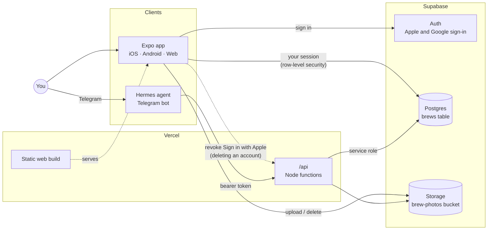
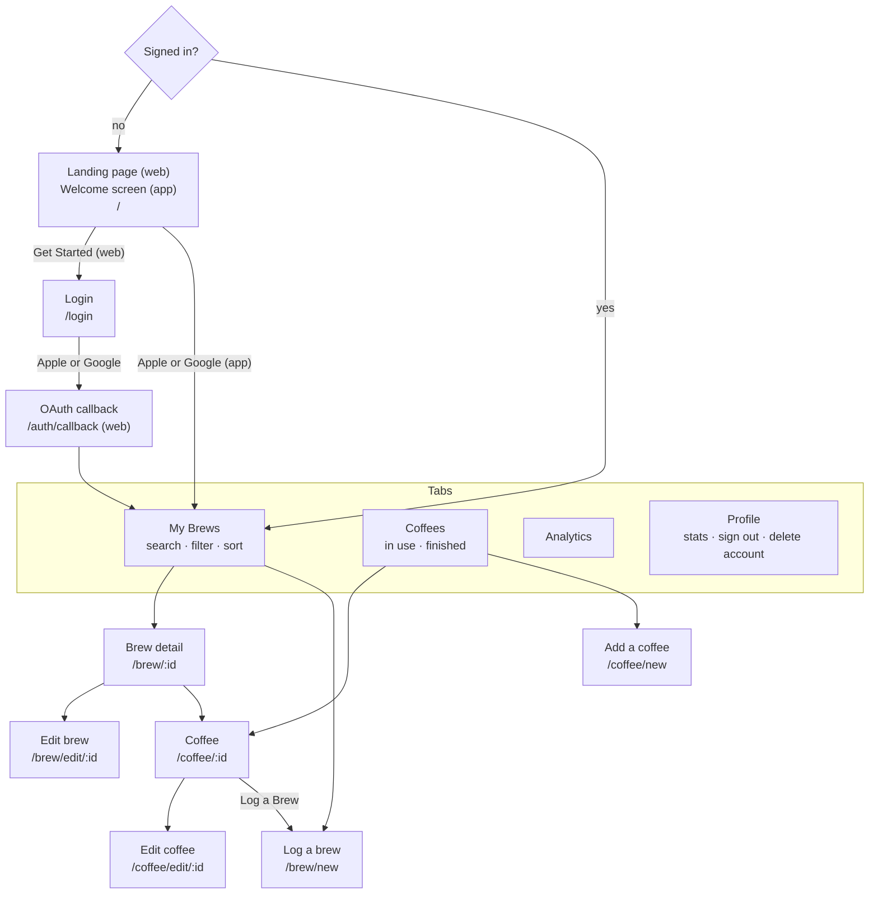
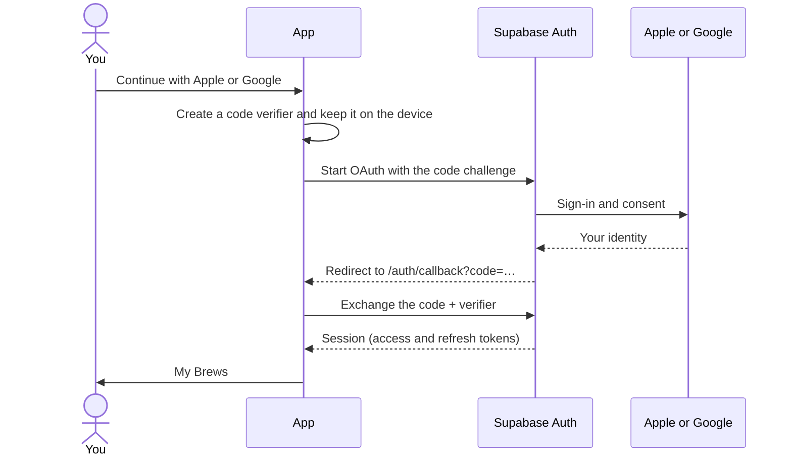
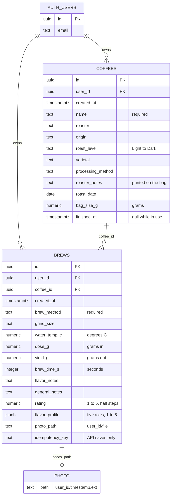
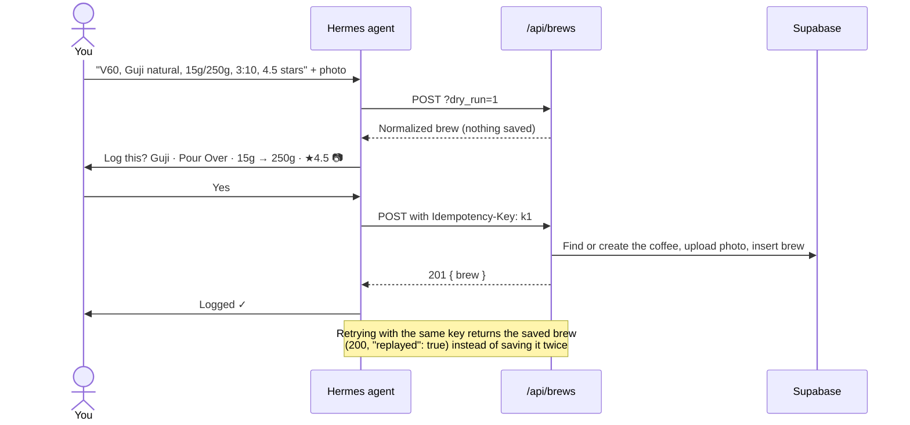
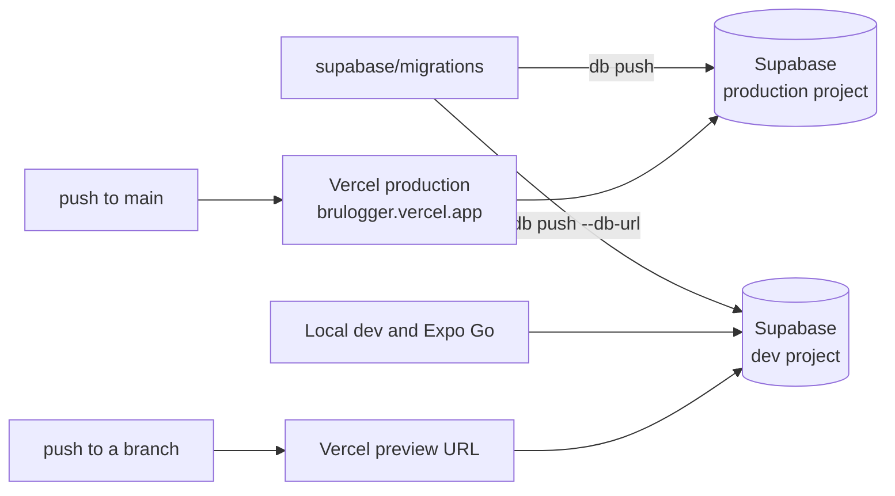

# BruLogger

[](https://github.com/antmelon/BruLogger/actions/workflows/ci.yml)

A personal coffee journal. Log every brew (the coffee, the recipe, how it tasted), rate it, add a photo, and see how your taste changes over time. You can also log brews by messaging a Telegram bot.

Live at **[brulogger.vercel.app](https://brulogger.vercel.app)**. The same codebase runs on iOS, Android and the web.

- [Features](#features)
- [Architecture](#architecture)
- [The app](#the-app)
- [Data model](#data-model)
- [Security](#security)
- [HTTP API (Telegram bot)](#http-api-telegram-bot)
- [Development](#development)
- [Database migrations](#database-migrations)
- [Environments and deployment](#environments-and-deployment)
- [Project layout](#project-layout)

## Features

- **Log a brew**: which coffee, the recipe (method, grind, water temperature, dose, yield, brew time), tasting notes, a 1–5 star rating in half stars, and a photo. A new brew starts with the coffee you used last.
- **Coffees you own**: each bag once (name, roaster, origin, roast level, varietal, processing, the roaster's tasting notes, roast date, bag size), then pick it for every brew. The Coffees tab shows days since roast, brews and average rating per coffee, and how much is left from the doses you logged, with a "running low" flag. Mark a bag finished when it's gone.
- **Flavor profile**: score aromatics, acidity, sweetness, aftertaste and body from 1 to 5, shown as a radar chart. It's optional, so averages only include brews you actually scored.
- **Browse your history**: search by coffee name, roaster, origin or flavor notes; filter by method, roast or minimum rating; sort by date, rating or name.
- **Analytics**: total brews, average rating, favorite method, rating over time, brews by method and roast level, and your average flavor profile.
- **Log from Telegram**: send the bot something like *"V60, Guji natural, 15g/250g, 3:10, blueberry, 4.5 stars"*, a photo of the bag, a photo of the cup, or any mix. It drafts the brew, asks you to confirm, and saves it. It can also fix or delete a logged brew and answer questions about past ones.
- **Private**: you sign in with Apple or Google, and each account sees only its own brews.

## Architecture

There is no custom backend for the app. It talks directly to Supabase, and Postgres row-level security keeps each user's data separate. The only server code is a small HTTP API on Vercel, for the Telegram bot and for revoking Sign in with Apple when an account is deleted.



| Piece | Built with |
| --- | --- |
| App | [Expo](https://expo.dev) SDK 57 (React Native 0.86, React 19), [Expo Router](https://docs.expo.dev/router/introduction/), React Native Web |
| Data fetching | [TanStack Query](https://tanstack.com/query) on top of [supabase-js](https://supabase.com/docs/reference/javascript) |
| Charts | Hand-drawn with `react-native-svg` (no chart library) |
| Backend | [Supabase](https://supabase.com): Postgres, Auth (Apple and Google sign-in), Storage |
| Hosting and API | [Vercel](https://vercel.com): the static web build plus Node functions in `api/` |
| Telegram bot | A [Hermes](https://github.com/NousResearch/hermes-agent) agent with the skill in [`integrations/hermes/log-brew`](integrations/hermes/log-brew/SKILL.md) |
| Crash reports | [Sentry](https://sentry.io), in the app (`lib/sentry.ts`) and the API (`server/api.ts`), production only |

## The app

### Screens

The root layout (`app/_layout.tsx`) acts as an auth gate. Signed-out visitors can only reach the landing page, the login screen and the OAuth callback; signed-in users go straight to their brews. The first screen differs by platform: the website shows a marketing page whose Get Started leads to the sign-in page, while the app shows a one-screen welcome with the sign-in buttons on it (`components/WelcomeScreen.tsx`). Both use the same buttons (`components/SignInButtons.tsx`).



Logging and editing a brew use the same form (`components/BrewForm.tsx`). Its first section picks the coffee from the ones in use, or adds a new one with the same fields as the coffee form (`components/CoffeeFields.tsx`). The roast date is typed ("Oct 5", "10/5", "yesterday") and read back under the field, since a date picker would need a new native build.

The [privacy policy](https://brulogger.com/privacy), [terms](https://brulogger.com/terms) and [support page](https://brulogger.com/support) (`app/(public)/`) are open whether you're signed in or not. They're linked from the landing page, the sign-in screen and Profile.

### Data loading

Screens never query Supabase themselves. They use the hooks in `lib/brewQueries.ts`, which wrap the data-access functions in `lib/brews.ts` and `lib/coffees.ts`:

- **One shared list.** Every tab reads the same cached `brews` query, so switching tabs doesn't refetch anything. Opening a brew shows the cached row right away. Each brew comes with its coffee. Coffees are one more cached list (`coffees`), and the per-coffee numbers are worked out from the brews list (`lib/coffeeStats.ts`). Editing a coffee refreshes both.
- **Staying fresh.** Data older than 30 seconds is refetched when a screen or the app regains focus, which is how brews logged from Telegram appear.
- **Writes.** Creating, editing and deleting update the cache directly. When a brew's photo is replaced or the brew is deleted, the old photo file is deleted, but only after the database write succeeds.
- **Photos.** A picked photo is shrunk before upload (`lib/photos.ts`): longest edge 1600 px, re-encoded as JPEG at 0.8 quality. HEIC and PNG photos get converted along the way.

### Installing the web app (Android)

Until there's a Play Store version, Android users install the website as an app. It opens full screen from the home screen, with its own icon and splash screen.

- **`public/manifest.webmanifest`** names the app and lists its icons. The icons in `public/icons/` come from `scripts/generate-icon.js`, like the native ones. The maskable icon keeps the cup inside the area every launcher shape leaves visible.
- **`public/index.html`** is the page template. Expo uses it in place of its default one. It links the manifest and registers the service worker. It also catches Chrome's install offer (`beforeinstallprompt`), so the landing page and Profile can show an **Install** button (`lib/install.ts`). The button only appears in browsers that offer installation (Chrome, Edge, Samsung Internet).
- **`public/sw.js`** is a service worker that does one thing: when a page can't load without a connection, it shows `public/offline.html` instead of the browser's error page. It caches nothing else. Brews live in Supabase anyway, and cached app files could keep serving an old version after a deploy.
- **No dead ends.** The installed app has no browser back button. So a brew screen opened with nothing behind it (a reload, or Android reopening the app) shows a back arrow to My Brews.

### Sign-in

You sign in with Apple or Google, through Supabase Auth. There are no passwords. Signing in through a web page (Google everywhere, Apple on the website) uses the PKCE flow: the redirect carries a one-time code that only the device that started the sign-in can exchange, never the tokens themselves.



On the web, the browser returns to `/auth/callback` and supabase-js does the exchange there. For Google on iOS and Android, the login screen opens an in-app browser, receives the `brulogger://auth/callback?code=…` redirect, and does the exchange itself. On native, the session token's refresh timer is restarted whenever the app comes back to the foreground.

**Sign in with Apple on iPhone** doesn't use a browser. The login screen shows Apple's own button, which opens the system's Apple sheet (Face ID). Apple returns a signed identity token, and the app hands it to Supabase (`signInWithIdToken`, in `lib/appleSignIn.ts`). A nonce stops a stolen token from being replayed: Apple signs the nonce's hash into the token, and Supabase checks it against the raw value only the app has. Apple shares the person's name only the first time they sign in, and not in the token, so the app saves it to the account then. The Android app doesn't offer Apple (Android users use the website).

**Deleting an Apple account.** Apple asks apps to revoke their Sign in with Apple access when an account is deleted. On iPhone, Delete Account first has the person confirm with Apple, which gives a fresh authorization code. `POST /api/apple/revoke` trades it for Apple's refresh token and revokes that, using Apple's signing key, which only the server has. Only then does the app delete the photos and the account, so closing the Apple sheet or a failed revocation leaves everything as it was. The website can't get that code, so deleting there leaves BruLogger listed in the person's Apple Account settings, where they can remove it themselves.

**Setup.** These live outside the repo:

- **Apple Developer portal:**
  - The App ID `com.antmelon.brulogger` has the Sign in with Apple capability. EAS turns it on when it builds, because `app.json` sets `usesAppleSignIn`.
  - The Services ID `com.antmelon.brulogger.web` is what the website signs in as. Its Sign in with Apple settings use that App ID as the primary one, with each Supabase project's domain (`<ref>.supabase.co`) and return URL (`https://<ref>.supabase.co/auth/v1/callback`), production and dev.
  - A Sign in with Apple key, with that App ID as primary. Its `.p8` file can only be downloaded once, so it's kept in a password manager.
- **Supabase, both projects** (Authentication → Sign In / Providers → Apple): enabled, with Client IDs `com.antmelon.brulogger.web,com.antmelon.brulogger`. The Services ID goes first, because the website's sign-in uses the first one; the bundle ID is for the iPhone app's identity tokens. The Secret Key is the website's client secret (below).
- **Vercel Production:** `APPLE_TEAM_ID`, `APPLE_KEY_ID` and `APPLE_PRIVATE_KEY` (the `.p8` file's contents), for revoking.

**Renewing the website's client secret.** The website's Apple sign-in needs a client secret: a JWT signed with the key, which Apple won't accept for longer than 6 months. When it expires, Continue with Apple fails on the website. The iPhone app and revoking keep working, because they don't use it. Before it expires, make a new one and paste it into both Supabase projects' Apple settings:

```sh
npm run -s apple:secret -- <team ID> <key ID> <path to AuthKey_XXXX.p8> | wl-copy   # valid 180 days
```

## Crash reports

Production errors from the app (iOS, Android and web) and from the API go to [Sentry](https://sentry.io), which emails when a new kind of error shows up. Reports are deliberately minimal, and the [privacy policy](https://brulogger.com/privacy) describes them:

- **Errors only.** No performance tracing, session tracking, session replay, screenshots or view hierarchy.
- **No personal data.** No name, email or IP address is attached, and the Sentry projects are set not to store IP addresses.
- **Secrets and IDs are scrubbed before sending.** Signed photo tokens and sign-in codes or tokens become `[Filtered]`, and account and brew IDs become `[id]`, anywhere in a report: breadcrumb URLs, error messages, the request URL (`scrubReport` in `lib/crashReports.ts`, unit-tested). So a report can't be tied to a person.
- **Readable stack traces.** The web build uploads its source maps (see Environments and deployment).

Reporting is on only where a DSN is set (Vercel Production), so local development and preview deploys report nothing. In the API, `reportError` logs a failure and reports it, and `withErrorReports` turns an unexpected exception in a handler into a reported 500.

## Accessibility

The app is built to work with VoiceOver, TalkBack, web screen readers and a keyboard, and at large system text sizes.

- **Every control says what it is.** Buttons, fields, choice pills (with which one is selected), headings and the photo all have roles and labels.
- **Drawn things are described.** The star rating, flavor radar, rating trend and bar charts are each read as one item with a spoken summary (`lib/a11y.ts`). For example: "Flavor profile, out of 5: aromatics 4, acidity 3.5, …". When rating a brew, the stars are a single adjustable control: swipe up or down with a screen reader, or use the arrow keys on the web, to move half a star.
- **Readable colors.** Every text color meets WCAG AA contrast (4.5:1) on every background, and chart lines meet 3:1. `__tests__/theme.test.ts` checks the theme tokens, so a color change can't quietly break this.
- **Large text.** Text follows the system text size. Only the tab bar labels (like iOS's own tab bars) and the decorative avatar letter stay fixed.

In October 2026, an axe-core audit of every screen of the web build found no WCAG 2.2 AA violations (down from 62 problems on 8 screens before this work).

## Data model

Each Brew is one row in `public.brews`, and each Coffee (a bag) one row in `public.coffees`, both owned by a Supabase Auth user. Every brew links to a coffee. A photo is a file in the private `brew-photos` storage bucket, stored under the owner's user ID; the brew keeps its storage path. For what each domain term means, see the [glossary](CONTEXT.md).



| Field | Rules |
| --- | --- |
| `brew_method` | Required. One of Pour Over, French Press, Espresso, AeroPress, Cold Brew, Other. |
| `roast_level` | Light, Medium-Light, Medium, Medium-Dark or Dark. |
| `rating` | 1–5 in half steps. |
| `flavor_profile` | `{ aromatics, acidity, sweetness, aftertaste, body }`, each 1–5 in half steps. All five axes or none. |
| `idempotency_key` | Set by the API when a save is retried; unique per user. The app leaves it empty. |
| `coffee_id` | The brew's coffee. The foreign key is `(coffee_id, user_id)`, so a brew can only use its owner's coffee. A coffee that still has brews can't be deleted; it's marked finished instead. |
| `bag_size_g` | Greater than 0. What's left is the bag size minus the doses logged for it. |

Every optional column is `null` when unset. To clear a field on update, send `null`; a missing key leaves the old value in place.

**Coffees, step 2 (pending).** App 1.0.0 reads and writes the coffee details on the brew itself, so until a newer build is the only one in use, `brews` still has `coffee_name`, `roaster`, `origin`, `roast_level`, `varietal` and `processing_method`, as copies of its coffee that database triggers keep current (`supabase/migrations/20261012195840_coffees.sql`). A brew 1.0.0 saves is linked to the coffee with that name and roaster, or a new one, and the other coffee details it saves (origin, roast level, varietal, process) go on to that coffee, so they change for all its brews, as they do in the new app. The app and the API never read the copies. Step 2, once the 1.0.0 build is gone, makes `coffee_id` required and drops the copies and the triggers.

The schema lives in [`supabase/migrations/`](supabase/migrations), and `types/database.ts` is generated from the live database. `types/index.ts` builds the app's `Brew` and `Coffee` types on top of it, narrowing the columns Postgres only knows as text or JSON (`brew_method`, `roast_level`, `flavor_profile`) and leaving out the copied coffee columns.

## Security

- **Row-level security** on `brews` and `coffees`: a signed-in user can read, create, update and delete only rows whose `user_id` is their own, and can't move one to another user. A brew's foreign key to its coffee includes `user_id`, so it can't point at someone else's coffee either.
- **Private photos**: the `brew-photos` bucket isn't public. Storage policies let users upload, read and delete only files in their own folder, and the app displays a photo through a signed link that expires after an hour. The bucket only accepts images up to 5 MB.
- **Account deletion**: Profile → Delete Account removes everything the user has stored. The app first deletes every file in their photo folder through the Storage API (SQL can't delete storage files), then calls the `delete_account()` database function, which deletes the user's auth account; their brews and coffees go with it (`on delete cascade`). Only signed-in users can call the function, and it only deletes the caller. If the photos can't be deleted, the account is left alone so the user can try again. On iPhone, an Apple account's Sign in with Apple access is revoked first (see Sign-in).
- **Apple's signing key** stays on the server (Vercel Production env), never in the app. `/api/apple/revoke` only answers callers with a valid Supabase session.
- **The anon key** in the app is public by design. It grants nothing beyond what row-level security allows.
- **The bot API** uses a single bearer token that maps to one configured user, and writes with Supabase's service role key, which bypasses row-level security. So the API handlers themselves limit every query to that user. The token is compared in constant time.

## HTTP API (Telegram bot)

The API exists so an agent can log brews on your behalf without a browser sign-in. It's single-user: one token, one account.



### Authentication

Send `Authorization: Bearer <BRULOGGER_API_TOKEN>` with every request. A missing or wrong token gets `401`.

### Endpoints

| Method and path | What it does | Success |
| --- | --- | --- |
| `GET /api/brews` | Brews, newest first. Query: `limit` (default 10, max 50), `since` (ISO 8601), `q` (case-insensitive match on the coffee's name, roaster or origin). | `200 { "brews": [...] }` |
| `POST /api/brews` | Creates a brew. Add `?dry_run=1` to validate and normalize without saving. | `201 { "brew": {...} }` |
| `GET /api/brews/:id` | One brew. | `200 { "brew": {...} }` |
| `PATCH /api/brews/:id` | Changes only the fields sent; `null` clears a field. | `200 { "brew": {...} }` |
| `DELETE /api/brews/:id` | Deletes the brew, then its photo. | `200 { "deleted": {...} }` |

An `:id` that doesn't exist, belongs to someone else or isn't a valid UUID gets `404`. Every brew comes back with its coffee as `coffee`.

### Request body

Brew fields use the column names from the [data model](#data-model). Input is forgiving where an agent is likely to vary, and strict where a mistake would otherwise be silent:

- Enum values match loosely: `"pour over"`, `"pour-over"` and `"Pour Over"` are all accepted.
- Numbers can be sent as strings, with a comma or a dot as the decimal separator. `brew_time_s` is rounded to whole seconds, and `rating` and flavor scores to half steps.
- Unknown fields are rejected, so a typo like `"dose"` instead of `"dose_g"` fails instead of being dropped.
- `created_at` is optional (it defaults to now) and can't be in the future.
- A photo is sent as `"photo": { "data": "<base64>", "mime_type": "image/jpeg" }`. JPEG, PNG, WebP and HEIC are accepted, up to 3 MB decoded, which keeps the request under Vercel's 4.5 MB limit. In a `PATCH`, `"photo": null` removes the photo.
- The coffee is `coffee_id`, or its details: `coffee_name` (required then), `roaster`, `origin`, `roast_level`, `varietal`, `processing_method`, `roaster_notes`, `roast_date` (`YYYY-MM-DD`) and `bag_size_g`. Not both. Details are matched to one of the user's coffees by name and roaster, ignoring case, preferring a bag still in use; a different roast date counts as a different bag. A match gets any details it was missing filled in (never changed). With no match, a new coffee is created. A dry run shows the coffee it would use, or the new one with `"id": null`.
- In a `PATCH`, `coffee_id` or a new coffee name or roaster moves the brew to that coffee (found or created). Other coffee details edit the brew's coffee, so they change for every brew of it.
- A `PATCH` can change `coffee_id`, `coffee_name`, `brew_method` and `created_at`, but can't clear them.

### Safe retries

Send an `Idempotency-Key` header (1–255 characters) with each `POST`, generated once per brew. If the request times out and is sent again with the same key, the API returns the brew it already saved (`200`, `"replayed": true`) instead of creating a duplicate. This also holds when two requests with the same key arrive at the same moment.

### Errors

```json
{ "error": "Invalid brew.", "details": ["brew_method must be one of: Pour Over, French Press, Espresso, AeroPress, Cold Brew, Other."] }
```

A `400` means nothing was written. Fix the fields named in `details` and retry.

### Example

```sh
curl -sS -X POST "https://brulogger.vercel.app/api/brews" \
  -H "Authorization: Bearer $BRULOGGER_API_TOKEN" \
  -H "Content-Type: application/json" \
  -H "Idempotency-Key: $(uuidgen)" \
  --data '{"coffee_name": "Guji Hambela", "brew_method": "pour over", "dose_g": 15, "yield_g": 250, "brew_time_s": 190, "rating": 4.5}'
```

### The Telegram agent

The agent's instructions are in [`integrations/hermes/log-brew/SKILL.md`](integrations/hermes/log-brew/SKILL.md): how to read a message or photo into a brew, when to ask, and the confirm-then-save workflow. The repo copy is the source of truth. After changing it, copy it into the Hermes agent's skills directory (`~/.hermes/skills/productivity/log-brew/` for the user Hermes runs as) and restart the agent.

## Development

### Prerequisites

- Node.js 20.19.4 or newer (Vercel builds with Node 24)
- A Supabase project to develop against (see [Environments](#environments-and-deployment))
- To run on a phone: [Expo Go](https://expo.dev/go) for SDK 57. For native builds, Xcode (iOS, macOS only) or the Android SDK.

### Setup

```sh
npm ci
```

On Linux distributions with a system libvips (for example Arch), `sharp` (used only by the icon script) tries to build from source and fails. In that case install with `SHARP_IGNORE_GLOBAL_LIBVIPS=1 npm ci`.

Create `.env.local` with the Supabase project the app should use:

```sh
EXPO_PUBLIC_SUPABASE_URL=https://<project-ref>.supabase.co
EXPO_PUBLIC_SUPABASE_ANON_KEY=<anon key>
```

If you have access to the Vercel project, `vercel env pull .env.local` fills these in with the development project's values.

### Running

| Command | What it does |
| --- | --- |
| `npm run web` | Dev server for the web app |
| `npm start` | Dev server for Expo Go. Scan the QR code with your phone. |
| `npm run ios` / `npm run android` | Native build on a simulator or device |

Notes for running on a phone:

- **Expo Go:** for an SDK 57 project, you have to be logged into the same Expo account in the CLI (`npx expo login`) and in the Expo Go app.
- **Redirect URLs:** Google sign-in needs the app's redirect allowed under the Supabase project's Authentication → URL Configuration: `exp://**` for Expo Go, `brulogger://**` for native builds.
- **Sign in with Apple** in Expo Go would need `host.exp.Exponent` added to the Supabase project's Apple Client IDs, since Expo Go's tokens are issued to it. It's simpler to test Apple in a TestFlight build.

### Checks

```sh
npm test            # Jest
npm run typecheck   # TypeScript, strict
npm run lint        # ESLint 9 over the whole repo
npx expo export --platform web   # production web build into dist/
```

GitHub Actions runs all of these on every pull request and every push to `main` ([`.github/workflows/ci.yml`](.github/workflows/ci.yml)), and fails on any lint warning.

The tests cover the pure helpers (list filtering, stats, form parsing, input validation, photo sizing), the data-access layer and the API handlers, with Supabase mocked. There are no component tests; screens are kept thin so the logic lives in tested modules.

## Database migrations

The schema is managed with the [Supabase CLI](https://supabase.com/docs/guides/local-development/cli/getting-started), which is a dev dependency, so run it with `npx supabase`. Never edit a migration that has already been applied.

```sh
npx supabase migration new add_grinder </dev/null   # creates supabase/migrations/<timestamp>_add_grinder.sql
# write the SQL, then apply it (reads SUPABASE_DB_PASSWORD):
npx supabase db push                                  # the linked project
npx supabase db push --db-url "postgresql://…"       # any other project, e.g. the dev one
npm run db:types                                      # regenerate types/database.ts
```

The `</dev/null` matters: when stdin isn't a terminal, `migration new` reads the migration body from it and waits.

To add, rename or remove a Brew field, follow the checklist in [`.claude/skills/add-brew-field`](.claude/skills/add-brew-field/SKILL.md). A field touches the migration, types, form, detail screen, API validation and the bot's skill.

## Environments and deployment

Vercel is connected to GitHub. Every push to `main` deploys to production; every other branch gets its own preview URL. Previews and local development use a separate Supabase project, so they never touch real data.



**Vercel project settings:** Node 24.x, output directory `dist`. The build command is set in `vercel.json`: `scripts/build-web.sh` runs `npx expo export --platform web` with source maps. When `SENTRY_AUTH_TOKEN` is set, it uploads the maps to Sentry, then deletes them so they aren't served. `vercel.json` sends every non-`/api` path to `index.html` so client-side routes work. Files in `api/` deploy as Node functions.

**Environment variables:**

| Variable | Used by | Environments |
| --- | --- | --- |
| `EXPO_PUBLIC_SUPABASE_URL` | App (built into the bundle) and API | Production; Preview and Development (dev project) |
| `EXPO_PUBLIC_SUPABASE_ANON_KEY` | App (built into the bundle) | Production; Preview and Development (dev project) |
| `SUPABASE_SERVICE_ROLE_KEY` | API | Production |
| `BRULOGGER_API_TOKEN` | API: the bot's bearer token | Production |
| `BRULOGGER_USER_ID` | API: the account the bot writes to | Production |
| `EXPO_PUBLIC_SENTRY_DSN` | App: where crash reports go (built into the bundle; unset means off) | Production |
| `SENTRY_DSN` | API: where error reports go | Production |
| `APPLE_TEAM_ID`, `APPLE_KEY_ID`, `APPLE_PRIVATE_KEY` | API: Apple's Sign in with Apple key (`.p8` contents), for revoking it when an account is deleted | Production |
| `SENTRY_AUTH_TOKEN`, `SENTRY_ORG`, `SENTRY_PROJECT` | Build: uploading web source maps to Sentry | Production |

`EXPO_PUBLIC_*` values are compiled into the web bundle at build time, so changing one needs a redeploy. The dev Supabase project is on the free plan and pauses after a week without use. If a preview fails with `ERR_NAME_NOT_RESOLVED`, restore the project from the Supabase dashboard.

## Releasing the iOS app

The iPhone app is built and submitted with [EAS](https://docs.expo.dev/eas/), Expo's cloud build service, so no Mac is needed. The project is [`@alongo0925/brulogger`](https://expo.dev/accounts/alongo0925/projects/brulogger). It's iPhone-only for now (`ios.supportsTablet: false`).

```sh
npx eas-cli build --platform ios --profile production   # cloud build, signed with EAS-managed Apple credentials
npx eas-cli submit --platform ios --latest              # upload to App Store Connect (TestFlight, then review)
npx eas-cli update --channel production --environment production --platform ios --message "…"   # ship a JavaScript-only fix to installed apps
npx eas-cli metadata:push                               # push the listing in store.config.json
npx eas-cli build --platform ios --profile preview --auto-submit   # TestFlight build that only gets preview updates
```

- **Uploading:** `eas build --auto-submit` builds and uploads in one go. If the upload step fails (it has failed once for no lasting reason), the build is still fine: `npx eas-cli submit --platform ios --latest` uploads it again.
- **Versions:** `version` in `app.json` is the version people see (1.0.0), and `store.config.json`'s `apple.version` repeats it for App Store Connect (a test checks they match). EAS keeps the build number and increments it on every production build (`appVersionSource: remote`, `autoIncrement`).
- **Over-the-air updates** (`expo-updates`): installed apps check for an update on launch and apply it on the next start. `eas update` bundles the app on your machine, so `--environment production` is required: without it, the bundle gets `.env.local`'s values, which point at the dev Supabase project. Updates only reach builds with the same `runtimeVersion`, which follows the app version (`policy: appVersion`). Anything that changes native code (a new native module, a config plugin, permissions) needs a new build, with `version` raised first. Otherwise a JavaScript update could reach a build that lacks the native code it needs.
- **Trying an update first:** a build from the `preview` profile is the same as a production one but listens to the `preview` channel, so an update can run on your own iPhone (through TestFlight) before installed apps get it. Publish with `--channel preview` instead of `production`, test, then publish the same commit to `production`. Publish after the build has finished: an app only switches to an update newer than the code built into it, so an update published before the build is ignored (republish it with `npx eas-cli update:republish --group <id>`, which gives it a new date). Make the preview build from the commit the App Store build came from, so what you test is what installed apps will run: that build's code plus the update. It uses the production database. Preview and production builds share one build-number count, so when submitting a version for review, choose the production build.
- **Build settings:** the `production` profile in `eas.json` uses the EAS `production` environment, whose variables are the same public values the website uses: `EXPO_PUBLIC_SUPABASE_URL`, `EXPO_PUBLIC_SUPABASE_ANON_KEY` and `EXPO_PUBLIC_SENTRY_DSN`. It also needs `SENTRY_AUTH_TOKEN` (a secret) to upload debug symbols to Sentry. Manage them with `npx eas-cli env:list` and `env:create`, or on expo.dev.
- **iOS settings in `app.json`:** camera and photo library permission messages (no microphone), Sign in with Apple (`usesAppleSignIn`), and `usesNonExemptEncryption: false`. The app only uses standard HTTPS encryption, which spares answering the export compliance question on every upload.

The listing and the rest of the submission are in [`docs/app-store.md`](docs/app-store.md).

## Backups

Supabase's free plan has no backups, and its paid backups leave out Storage files anyway. So a home server backs up production every night at 23:15:

- **Database:** a `pg_dump` (custom format), signed in as `brulogger_backup`, a read-only role. It covers the `public`, `auth` and `storage` schemas: brews and coffees, accounts and linked Apple and Google identities, and the bucket and photo records. Sign-in sessions, refresh tokens, MFA claims and the auth audit log are left out, so a leaked dump can't be used to sign in. After a restore, people sign in again. Before a dump is kept, it must list the `brews` data.
- **Photos:** the `brew-photos` bucket is mirrored with rclone over Supabase Storage's S3 endpoint.
- **Retention:** 14 days of dumps on the server. The server's own encrypted restic backup copies them off-site every night and keeps months of history.
- **Failures** send a Telegram message.

The job itself is defined in the server's own configuration, not in this repo.

### Restoring

**Into a fresh Supabase project** (the old one is gone):

1. Create the project, link it (`npx supabase link`) and run `npx supabase db push`. The migrations recreate the schema and the private `brew-photos` bucket.
2. Load the accounts first, then the brews, which reference them:
   ```sh
   pg_restore --data-only --no-owner --schema=auth --table=users --table=identities -d "$NEW_DB_URL" brulogger-<date>.dump
   pg_restore --data-only --no-owner --schema=public --table=brews -d "$NEW_DB_URL" brulogger-<date>.dump
   ```
3. Upload the photos to the same paths: `rclone copy photos/ <new-project-remote>:brew-photos`.
4. Point the app at the new project: the Vercel environment variables, `.env.local`, the EAS `production` environment, and Supabase Auth's Apple and Google providers and redirect URLs. Add its callback URL to the Apple Services ID too.

**Undoing a mistake** (a bad migration, deleted brews): restore the dump into a throwaway Postgres (`pg_restore --no-owner --no-acl`; errors about Supabase's roles are expected), then copy the rows you need back.

Restoring a dump into plain Postgres has been tested. A full restore into a new Supabase project hasn't been rehearsed yet.

## Project layout

```text
app/                    Screens (Expo Router: one file per route)
  _layout.tsx           Auth gate, data cache provider
  index.tsx             Landing page (web), welcome screen (app)
  (auth)/login.tsx      Apple and Google sign-in
  auth/callback.tsx     Finishes web sign-in
  (tabs)/               My Brews, Coffees, Analytics, Profile
  (public)/             Privacy policy, terms, support (no sign-in needed)
  brew/                 Detail, new, edit
  coffee/               Detail, new, edit
components/             BrewForm, CoffeeForm, CoffeeFields, FormFields, RadarChart, StarRating, SliderInput, SignInButtons, WelcomeScreen, LegalPage, icons
lib/
  brews.ts              Data access for brews (with their coffee) and photos
  coffees.ts            Data access for coffees; with brews.ts, the only place that queries Supabase for them
  account.ts            Account deletion
  appleSignIn.ts        Sign in with Apple on iPhone, and revoking it
  crashReports.ts       Scrubs secrets out of crash reports
  sentry.ts             Starts crash reporting (production only)
  authGate.ts           Which screens need sign-in (used by the root layout)
  install.ts            Install button for the web app
  a11y.ts               What screen readers say for ratings, cards and charts
  brewQueries.ts        TanStack Query hooks used by screens
  brewList.ts           Search, filter, sort for My Brews
  analytics.ts          Stats and averages
  coffeeStats.ts        Days since roast, what's left, stats per coffee, coffee order in lists
  form.ts               Form values → save payload, with validation; reads typed roast dates
  brewInput.ts          API input validation
  coffeeMatch.ts        Which of the user's coffees the API's coffee details mean
  photos.ts             Resize before upload
  storage.ts            Photo bucket name
  supabase.ts           Supabase client
  theme.ts              Color and shadow tokens
api/brews/              Vercel functions: index.ts (list, create), [id].ts (get, update, delete)
api/apple/revoke.ts     Vercel function: revokes Sign in with Apple when an account is deleted
server/api.ts           Shared API helpers: auth, responses, photos
server/coffees.ts       The API's coffee lookups: find, create, fill in, move a brew
server/apple.ts         Apple client secrets and token revocation
eas.json                EAS build and submit profiles (iOS releases)
store.config.json       App Store listing (EAS Metadata); docs/app-store.md covers the rest
public/                 Copied into the web build: page template, web app manifest and icons, service worker, offline page
types/                  Generated database types and the app's Brew and Coffee types
supabase/migrations/    Database schema
integrations/hermes/    The Telegram agent's skill
__tests__/              Jest tests
scripts/                Icon generation, web build, Apple client secret
```

For agents working in this repo, [`CLAUDE.md`](CLAUDE.md) has the conventions and gotchas. [`CONTEXT.md`](CONTEXT.md) defines the domain terms.
